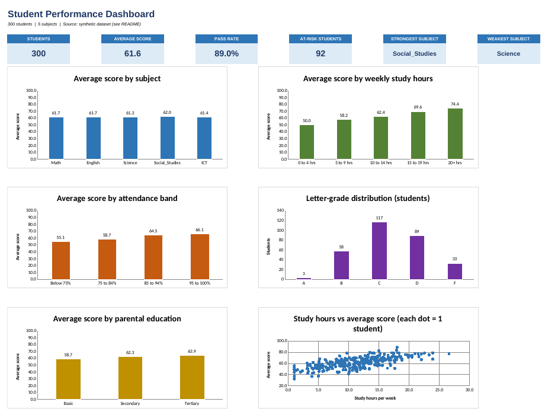

# Student Performance Analysis (Excel)

An end-to-end Excel analysis of 300 students across five subjects. It answers a practical school question: **which factors are linked to better results, and which students need support first?**



## Business questions

1. What are the overall average score and pass rate?
2. Which subjects are weakest and strongest?
3. How do study hours, attendance, gender, parental education and internet access relate to performance?
4. Which students are **at risk** and should be supported first?

## Key findings

| # | Finding |
|---|---------|
| 1 | The cohort averages **61.6** with an **89.0%** pass rate (pass mark 50). |
| 2 | Study time shows the strongest link: students studying 20+ hrs/week average **74.4** vs **50.0** for those under 5 hrs (r = **0.68**). |
| 3 | Attendance shows a moderate link: **66.1** for 95-100% attendance vs **55.1** below 75% (r = **0.40**). |
| 4 | Gender gaps are subject-specific: females lead English by 4.5 points, males lead Math by 2.6, while overall averages are equal (61.6). |
| 5 | Students with home internet average 62.9 vs 59.0 without; tertiary-educated parents 63.9 vs 58.7 for basic. |
| 6 | **92 students (30.7%)** are flagged at-risk (average below 55 or attendance below 75%). |
| 7 | Subject averages are almost identical (61.3 to 62.0), so students' study habits matter more than which subject they take. |

> **Note on the data:** the dataset is **synthetic** (generated with a fixed random seed by `scripts/generate_dataset.py`). The findings demonstrate the method; they are not facts about a real school. See *Using real data* below.

## What's inside the workbook

`excel/Student_Performance_Analysis.xlsx`

| Sheet | Purpose |
|-------|---------|
| Dashboard | KPI cards and 6 charts |
| Insights | Formula-driven findings, recommendations, limitations |
| Analysis | KPIs, subject table, group comparisons, grade distribution, correlations |
| Top_Bottom | Top 10 and bottom 10 students |
| Data | 300 students; input columns (blue) + calculated columns (formulas) |
| Settings | Pass mark, at-risk rules, grade scale and band definitions (editable) |
| Data_Dictionary | Every column explained |

## Methodology

- **Inputs** are on `Data` (blue text). Everything else is a formula, so changing a score or a rule on `Settings` updates the whole workbook.
- **Calculated columns:** `Average`, `Letter_Grade`, `Result`, `Study_Band`, `Attendance_Band`, `At_Risk`, `Rank`.
- **Functions used:** `AVERAGE`, `COUNTIFS`, `AVERAGEIFS`, `IF`, `OR`, `LOOKUP`, `INDEX/MATCH`, `RANK`, `CORREL`, `MEDIAN`, `STDEV`, `IFERROR`, `TEXT`.
- **Data quality:** data-validation lists and 0-100 limits on input columns; conditional formatting highlights fails, at-risk students and a score colour scale.
- **Assumptions** (all editable on `Settings`): pass mark 50; at-risk = average < 55 or attendance < 75%; A-F scale 80/70/60/50.

## Repository structure

```
student-performance-analysis/
├── README.md
├── .gitignore
├── data/
│   └── student_performance.csv
├── excel/
│   └── Student_Performance_Analysis.xlsx
├── docs/
│   ├── STEP_BY_STEP_GUIDE.md
│   └── GITHUB_PUSH_GUIDE.md
├── images/
│   └── dashboard.png
└── scripts/
    └── generate_dataset.py
```

## How to use

1. Download or clone the repo.
2. Open `excel/Student_Performance_Analysis.xlsx` in Excel 2010 or later (also works in LibreOffice and Google Sheets).
3. Start on **Dashboard**; explore **Analysis**; tweak thresholds on **Settings**.
4. To rebuild the data: `pip install numpy pandas` then `python scripts/generate_dataset.py`.

## Using real data

Paste real records into `Data` columns A-M (same headers) and extend the formulas in N-T down. Good public datasets: the **UCI Student Performance** dataset (Portuguese secondary schools) or Kaggle student-performance datasets. Check each dataset's licence and never publish identifiable student data.

## Limitations

- Synthetic data, so no real-world conclusions.
- Correlation is not causation.
- All five subjects are weighted equally in `Average`.

## Possible next steps

- Add PivotTables with Slicers for interactive filtering.
- Add a regression (Data Analysis ToolPak) to estimate the effect of study hours while controlling for attendance.
- Rebuild the dashboard in Power BI or Tableau.

## Skills demonstrated

Data cleaning and validation · formulas and lookups · statistical summaries and correlation · charting · dashboard design · documentation · Git and GitHub.

## Author

Pearl Korang · Linkedin: https://www.linkedin.com/in/pearl-korang-46518b250?
Github: https://github.com/Pearl28-me

